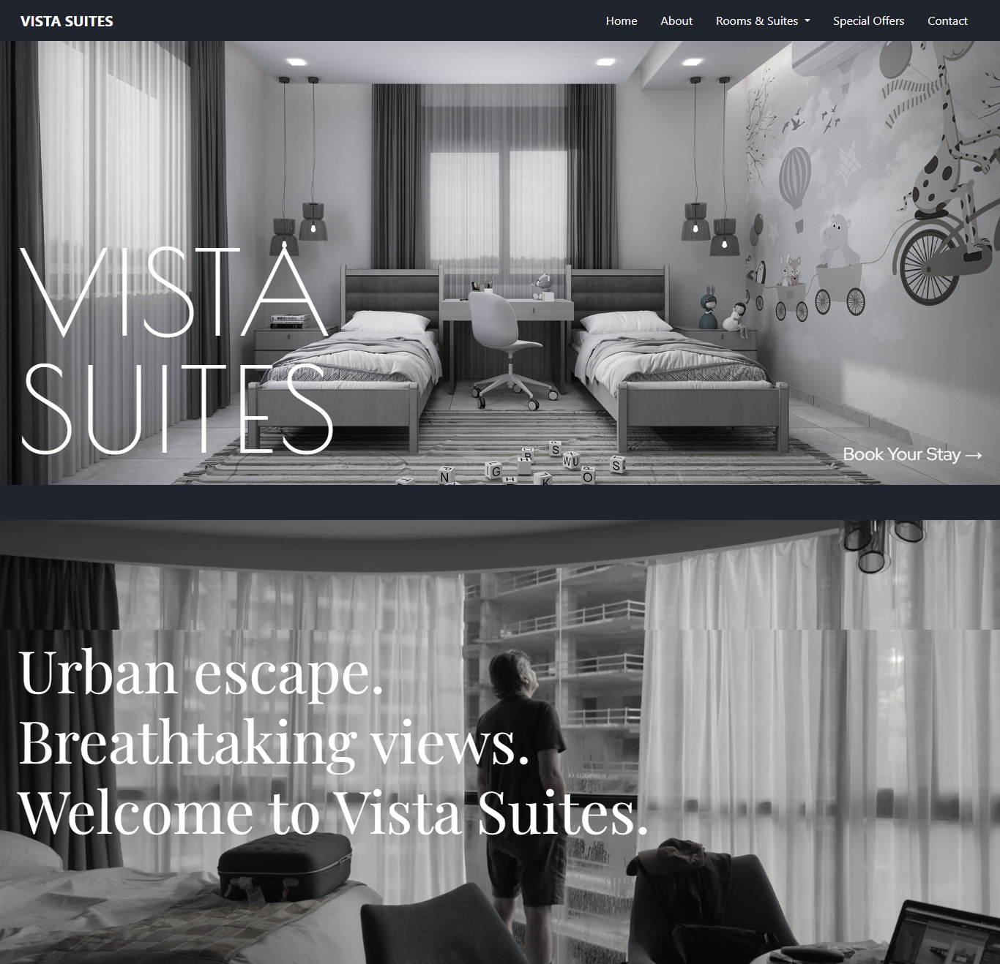

# VISTA SUITES 🏨

### Modern Hotel Website | Elegant • Minimal • Responsive

VISTA SUITES is a modern and elegant hotel website designed to showcase a premium hospitality experience. It features a sophisticated **grey, beige, and black** color palette, stylish typography, and a clean, luxurious layout.

The project focuses on creating a visually appealing and user-friendly experience for visitors exploring a hotel website.

## ✨ Features

- Elegant and minimalist hotel design
- Sophisticated grey, beige, and black color scheme
- Fully responsive layout for desktop, tablet, and mobile devices
- Modern typography and stylish visual elements
- Clean navigation and structured page sections
- Attractive hotel imagery and presentation
- User-friendly interface

## 🎨 Design

The website uses a carefully selected color palette to create a calm and luxurious atmosphere.

- **Grey:** A modern and balanced appearance
- **Beige:** Warmth and elegance
- **Black:** Sophistication and contrast

## 🛠️ Technologies Used

- HTML5
- CSS3
- JavaScript
- Bootstrap 5
- jQuery

## 📸 Preview

  

## 📱 Responsive Design

VISTA SUITES is designed to provide a consistent browsing experience across different screen sizes, including desktop computers, tablets, and mobile phones.

## 🎯 Project Goals

- Practice modern frontend development
- Improve responsive web design skills
- Explore minimalist and luxury-inspired UI design
- Build a professional hotel website portfolio project

## 👨‍💻 Author

**Your Name**

- GitHub: [GitHub](https://github.com/battleshopventureswaqas-blip)

